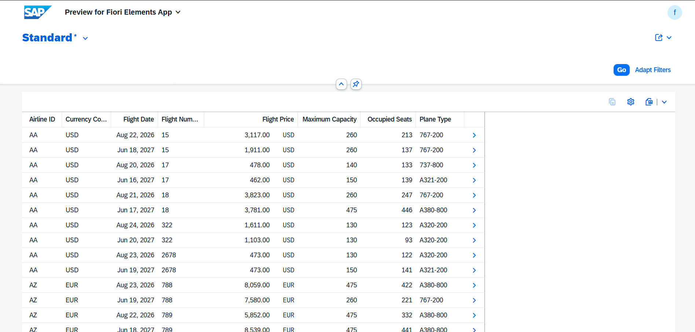

ABAP Mini Project – Flight Report (Fiori Elements App)

This ABAP mini project exposes the standard flight table `/DMO/FLIGHT` as a Fiori Elements App using RAP (Read-Only).
It showcases how to use CDS View Entity, Service Definition and Service Binding to generate a Fiori App without any custom UI5 code.

💡 Features
- CDS View Entity implementing `ZI_MM_FLIGHT_P1` on standard table
- Service Definition `ZSD_FLIGHT_P1` exposing entity as `FlightP1`
- Service Binding `ZSB_FLIGHT_P1` with `OData V2 - UI` type
- Outputs results in Fiori Elements List Report with Filters

📄 Sample Output
Airline ID, Flight Number, Flight Date, Price, Maximum Capacity, Occupied Seats

Fiori List Report Preview with data from `/DMO/FLIGHT` table.

📁 File Structure
